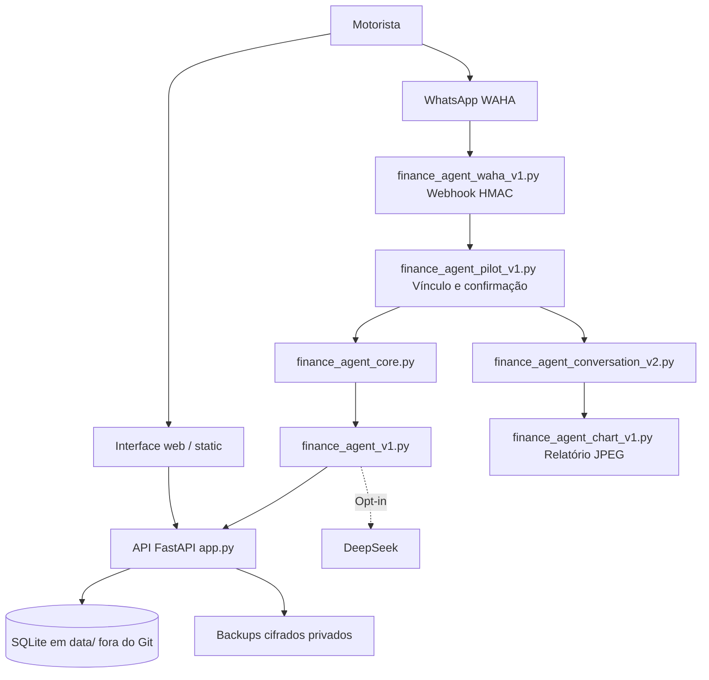

# MOVI+ — Organograma da arquitetura

Sistema revisado na VPS da Hostinger. Os módulos Python da inteligência ficam na raiz do projeto; não existe uma única pasta `inteligencia/` na implantação atual.

## Visão técnica

## Áreas e arquivos — onde mexer

| O que mudar | Arquivo / pasta | Teste a executar |
|---|---|---|
| Classificação APLICATIVO / OUTROS, Uber e 99 | `finance_agent_core.py` | `deploy/test_finance_agent.py` |
| Linguagem, confirmação humana, consulta e relatório | `finance_agent_conversation_v2.py` | `deploy/test_finance_agent_waha.py` |
| Inteligência DeepSeek, leitura de texto/foto/voz | `finance_agent_v1.py` | `deploy/test_deepseek_flash.py` |
| Controle de tokens e assuntos aceitos | `finance_agent_limits_v1.py` | `deploy/test_finance_scope_limits.py` |
| Entrada de mensagens WhatsApp, assinaturas HMAC | `finance_agent_waha_v1.py` | `deploy/test_finance_agent_waha.py` |
| Confirmação de lançamentos e resposta via WAHA | `finance_agent_pilot_v1.py` | `deploy/test_finance_agent_waha.py` |
| Montagem do JPEG financeiro | `finance_agent_chart_v1.py` | `deploy/test_finance_agent_waha.py` |
| Sessão WAHA e dados de integração | `whatsapp_bridge_v5.py` | `deploy/test_whatsapp_bridge.py` |
| Visão financeira do motorista | `static/finance-agent-v1.js` | `deploy/test_finance_agent_ui.js` |
| Landing page / divulgação | `static/landing-v1.css`, `static/landing-v1.js` | `deploy/test_public_landing_ui.js` |
| Navegação, login, abas, CSS | `static/app.js`, `static/style.css`, `static/index.html` | `deploy/test_public_landing_ui.js` |
| Cadastro, questionário e consentimentos | `schema.py`, `socio_assisted_v5.py` | `deploy/test_socio_progress.py` |
| Campanhas, tarefas, benefícios | `program_stage2_v5.py` | `deploy/test_stage2.py` |
| Banco de dados e rotas principais | `app.py` | `deploy/test_finance_agent.py` |
| Auditoria, MFA, segurança | `security_stage3_v5.py` | `deploy/test_stage3_mfa.py` |
| Verificação de saúde e backups | `healthcheck_stage3.py`, `backup.py`, `deploy/` | testes de implantação |

## Separação entre produção e código

**VPS operacional:** `/srv/clube-motorista-v3/financeiro-secure-v5/`

**Cópia de entrega MOVI+:** `/srv/clube-motorista-v3/MOVI-PLUS/`

**Dados privados (não versionados):** `data/`, `waha_private/`, `backups/`, `.backup-master-key`, `.venv/` e arquivos de sessão.

**Repositório externo pretendido:** `tmbmartell/MOVI-PLUS`, com visibilidade privada. O vínculo GitHub NÃO existe ainda.

## Histórico e versões

`release-v4/`, `release-v4-1/` e `release-v5/` são diretórios irmãos mais antigos. O serviço ativo usa `financeiro-secure-v5/`. Mudanças no GitHub não mudam produção automaticamente.
